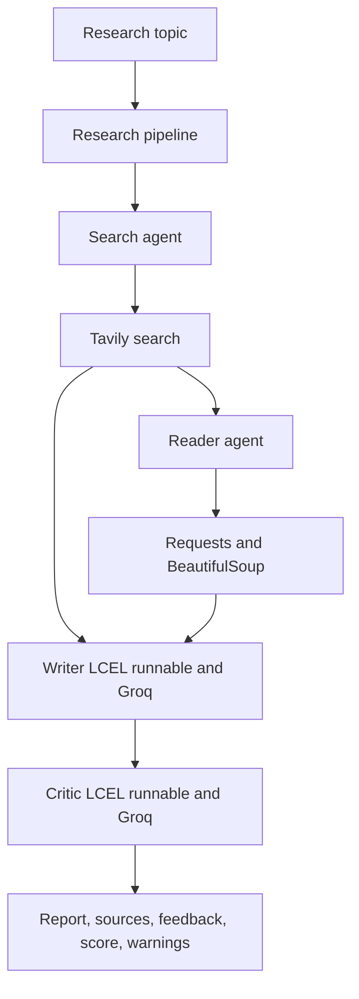

# Multi-Agent Research System

## Overview

This Python application is for users who want to investigate a topic and receive a report with source links and a critic review. It searches the web, reads selected pages, generates a report, and reviews that report. It can be used from the command line, imported as a Python function, or accessed through a local web interface.

## Features

- Searches the web with Tavily and returns source titles, URLs, and snippets.
- Uses separate LangChain agents for web search and page reading.
- Extracts readable HTML page text with Requests and BeautifulSoup, subject to configured size limits.
- Uses LCEL runnables with Groq for report writing and critic review.
- Returns a report with source links, critic feedback, an optional 1–10 score, and pipeline warnings.
- Provides a FastAPI endpoint and a browser interface for submitting topics, viewing results, and copying or downloading the report as Markdown.
- Provides a standalone Tavily search command.

## Technologies Used

- Python
- LangChain, LangChain Core, and LangGraph
- LangChain Groq integration and the Groq API
- Tavily Python client and Tavily API
- Requests and BeautifulSoup 4
- FastAPI, Uvicorn, and Pydantic
- HTML, CSS, and JavaScript
- python-dotenv for loading local environment settings

## Data and Storage

- Tavily receives the search query. Groq receives prompts containing the topic and gathered research for the agents, writer, and critic. The server also fetches selected source URLs over HTTP or HTTPS.
- The pipeline keeps its working state in memory and returns it to the caller. No database or persistent report history is implemented.
- The web interface can download the report as a Markdown file through the browser. The application does not save that download on the server.
- API keys are loaded by the Python application from environment variables or `.env`. The `.env` file is excluded from Git; `.env.example` contains placeholders.
- Retention of requests or results by Tavily, Groq, and source websites is not specified by this project.

## Requirements

- Python 3.10 or newer
- A Groq API key and a Tavily API key
- Network access to Groq, Tavily, and the source websites
- A web browser to use the web interface

Configuration values available in `.env.example`:

| Variable | Default | Description |
| --- | --- | --- |
| `GROQ_API_KEY` | Required | Groq API key |
| `TAVILY_API_KEY` | Required | Tavily API key |
| `GROQ_MODEL` | `openai/gpt-oss-120b` | Groq chat model |
| `LLM_TEMPERATURE` | `0` | Model temperature; valid range is 0–2 |
| `MAX_SEARCH_RESULTS` | `5` | Search result count; valid range is 1–10 |
| `MAX_SCRAPED_PAGES` | `2` | Page count to read; valid range is 1–5 |
| `REQUEST_TIMEOUT` | `15` | Page request timeout in seconds; must be greater than 0 |
| `MAX_PAGE_BYTES` | `2000000` | Maximum HTML bytes fetched per page; must be greater than 0 |
| `MAX_PAGE_CHARS` | `8000` | Maximum extracted text characters per page; must be greater than 0 |

## Project Workflow



If the search agent does not return usable results, the pipeline calls Tavily directly. If the reader agent does not return scraped text, the pipeline tries direct page reading.

## Project Layout

```text
.
├── UI.py                  # FastAPI application and research API endpoint
├── agents.py              # Groq model, search/reader agents, writer/critic runnables
├── config.py              # Environment loading and settings validation
├── pipeline.py            # Research workflow and command-line entry point
├── tools.py               # Tavily search and BeautifulSoup page-reading tools
├── requirements.txt       # Python dependencies
├── .env.example           # Placeholder environment configuration
├── README.md
└── static/
    ├── index.html         # Web interface layout
    ├── css/styles.css     # Web interface styles
    └── js/app.js          # Browser interactions and API requests
```

## Setup

From the project directory, create a virtual environment and install the dependencies. The commands below are for PowerShell:

```powershell
python -m venv .venv
.venv\Scripts\Activate.ps1
python -m pip install -r requirements.txt
Copy-Item .env.example .env
```

Edit `.env` and replace the placeholder values for `GROQ_API_KEY` and `TAVILY_API_KEY` with valid keys. The remaining settings are optional.

## Run or Usage Instructions

### Web interface

Start the local FastAPI server:

```powershell
python -m uvicorn UI:app --reload
```

Open <http://127.0.0.1:8000> in a browser. The interface sends research requests to `POST /api/research` and displays the returned report, sources, critic feedback, score, and warnings.

### Command-line research pipeline

Pass a topic as a quoted argument:

```powershell
python pipeline.py "How are heat pumps changing home energy use?"
```

If the topic is omitted, the CLI prompts for one:

```powershell
python pipeline.py
```

### Standalone search tool

```powershell
python tools.py "recent advances in renewable energy"
```

## Optional Modes and Commands

### Python function

```python
from pipeline import run_research_pipeline

result = run_research_pipeline("How are heat pumps changing home energy use?")
print(result["report"])
print(result["score"])
print(result["sources"])
```

The returned dictionary includes `topic`, `search_results`, `scraped_content`, `report`, `feedback`, `score`, `sources`, and `warnings`.

### HTTP endpoints

- `GET /health` returns the web server status.
- `POST /api/research` accepts a JSON body with a `topic` string. Topics must contain 1–500 non-whitespace characters after trimming.

## License and Copyright

- License: MIT. See [LICENSE](LICENSE).
- Copyright notice displayed in the UI: © 2026 Bishnuprasad.

## Conclusion

The project provides a local, source-grounded research workflow through a CLI, Python function, and browser interface. It uses Tavily for search, BeautifulSoup for page text extraction, and Groq-backed LangChain agents and LCEL runnables for report generation and review.
